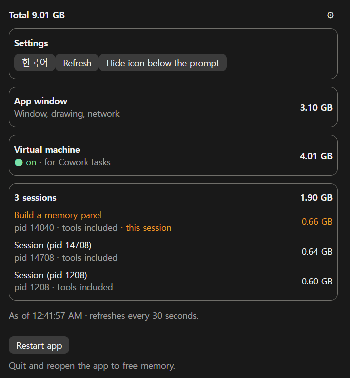
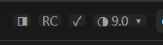

# RAM Watch

[English](README.md)

Windows용 Claude 데스크톱 앱이 지금 메모리를 얼마나 쓰는지 보여 주는 옆 패널. 앱 화면, Cowork 가상 머신, Claude Code 세션마다 따로 보여 준다. 무거워지면 버튼 하나로 앱을 껐다 켜서 가상 머신까지 다시 시작하고 메모리를 비운다.

Claude Code mod라서 데스크톱 앱 안에서 돌고, 서버·계정·API 키가 필요 없다.



*그림은 `/ram-watch demo`의 예시 숫자다.*

## 기능

- **네 덩어리:** 앱 화면, 가상 머신(켜짐·꺼짐과 크기), 세션들. 세션은 그 세션이 띄운 도구(MCP 서버 등)까지 더한 크기다. 지금 세션은 제목과 함께 주황색으로 표시된다.
- **입력창 아래 버튼:** 을 누르면 패널이 열리고 닫힌다. 숫자는 Claude가 쓰는 메모리 합계(GB), 원은 PC 전체 메모리 중 **Claude가 차지한 몫**만큼 찬다(○ ◔ ◑ ◕ ●). `/ram-watch`도 같다.
- **앱 재시작:** **앱 재시작**을 5초 안에 두 번 누른다. 모든 세션이 끊긴다.
- **한국어·영어:** 설정(⚙)에서 고르고, 고른 언어를 기억한다.

숫자는 30초마다 저절로 새로 고친다.

예시 숫자로 패널을 보려면 `/ram-watch demo`를 친다. 아무것도 재지 않고, 재시작 버튼도 아무 일을 하지 않는다. `/ram-watch`를 치면 실제 숫자로 돌아간다.

> **주의: 원은 PC 전체 메모리 점유율이 아니다.** 작업 관리자의 "메모리 94%"는 PC의 모든 프로그램을 합친 값이고, 이 mod의 원은 그중 Claude 프로세스(앱·가상 머신·세션)만 더한 몫이다. 그래서 작업 관리자가 94%여도 원은 반쯤 찬 것으로 보일 수 있다.

## 설치

Windows, Claude 데스크톱 앱, Claude Code CLI가 필요하다. 터미널 세션의 입력창에서:

```
/plugin install ram-watch --marketplace dshw1234-dot/ram-watch
```

마켓플레이스를 더할지 물으면 `y`, 범위는 user를 고른다. 셸에서는:

```bash
claude plugin install ram-watch --marketplace dshw1234-dot/ram-watch
```

`/plugin`이 안 되는 데스크톱 앱에서는: 입력창 옆 + → Plugins → Add marketplace에 `dshw1234-dot/ram-watch` → Add plugin.

## 재는 방법

30초마다 PowerShell을 1초 안쪽(CPU 약 0.7초, 최대 144MB) 띄워 프로세스 목록을 읽고, 프로세스별 개인 메모리를 더한다.

| 덩어리 | 프로세스 |
| --- | --- |
| 앱 화면 | `WindowsApps\Claude_*` 아래 `Claude.exe` |
| 가상 머신 | `vmmem` (Cowork 가상 머신) |
| 세션 | `claude-code\` 아래 `claude.exe` 각각과, 그것이 띄운 모든 프로세스 |

결과는 `%TEMP%\claude-ram-watch\snap.json`에 두고 모든 세션이 함께 쓴다. 파일이 27초보다 오래됐을 때만 한 세션이 다시 재므로, 세션이 몇 개든 부담은 거의 같다. 각 세션은 자기 표시를 위해 처음 한 번만 자기 프로세스를 찾는다.

## 앱 재시작

처음 누르면 5초 안에 한 번 더 누르라고 묻는다. 그러면 앱보다 오래 살도록 WMI로 따로 띄운 PowerShell이 Claude 앱과 모든 세션을 끄고, Cowork 가상 머신 서비스(`CoworkVMService`, 일반 사용자도 껐다 켤 수 있음)를 껐다 켠 뒤 앱을 다시 연다.

## 한계

- Windows 전용(Microsoft Store판 Claude 앱 경로를 본다).
- 이름이 `vmmem`인 프로세스를 Claude 가상 머신으로 본다. Docker·Windows 샌드박스가 함께 돌면 그 몫이 섞일 수 있다(WSL은 `vmmemWSL`이라 섞이지 않는다).
- 다른 세션은 제목 대신 pid로 보인다. 지금 세션만 제목을 보여 준다.
- 메모리는 프로세스별 개인 메모리(커밋) 합이라 작업 관리자 숫자와 조금 다를 수 있다.

## 읽고 보내는 것

- 이 PC의 프로세스 목록과 전체 메모리 크기를 PowerShell·WMI로 읽는다.
- 지금 세션 제목을 앱의 `get_session` 도구로 읽는다. 그 도구가 이미 허용된 경우에만(권한 창을 띄우지 않는다).
- `%TEMP%\claude-ram-watch\`에 작은 파일 두 개를 쓰고, 언어·버튼 설정을 mod 자체 저장소에 둔다.
- 네트워크로는 아무것도 보내지 않는다.

## 같은 만든 이의 mod

- [RC Panel](https://github.com/dshw1234-dot/rc-panel): Remote Control이 켜진 세션 보기.
- [Session Tree](https://github.com/dshw1234-dot/session-tree): 세션을 폴더별 가계도로 보기.

## 라이선스

[MIT](LICENSE)
