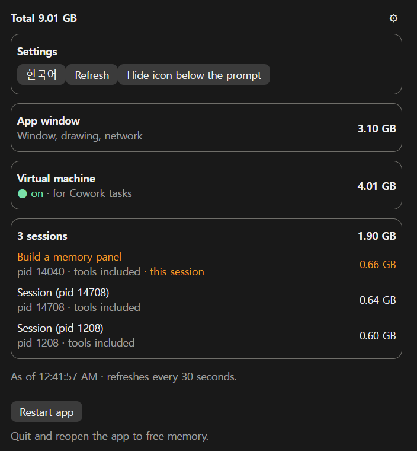
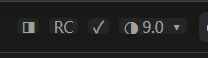

# RAM Watch

[한국어](README.ko.md)

A side panel for the Claude desktop app on Windows that shows how much memory Claude is using right now: the app window, the Cowork virtual machine, and each Claude Code session. When it gets heavy, one button quits and reopens the app, which also restarts the virtual machine and frees its memory.

It is a Claude Code mod: it runs inside the desktop app and needs no server, account or API key.



*The screenshot uses the sample data from `/ram-watch demo`.*

## Features

- **Four blocks:** the app window, the virtual machine (on or off, and its size), and the sessions, each with its own size including the tools it started (MCP servers and so on). The current session shows its title and is marked in orange.
- **Button below the prompt:**  opens and closes the panel. The number is Claude's total in GB, and the circle fills with Claude's share of the PC's memory (○ ◔ ◑ ◕ ●). `/ram-watch` does the same.
- **Restart the app:** press **Restart app** twice within 5 seconds. Every session stops.
- **Korean and English:** pick one in the settings (⚙). The choice is remembered.

The numbers refresh every 30 seconds.

To see the panel with sample numbers, type `/ram-watch demo`. It measures nothing, and its restart button does nothing. `/ram-watch` goes back to the real numbers.

> **The circle is not the PC's overall memory use.** Task Manager's "Memory 94%" counts every program on the PC. The circle counts only Claude's processes (the app, the virtual machine and the sessions). So Task Manager can read 94% while the circle is half full.

## Install

Needs Windows, the Claude desktop app and the Claude Code CLI. At the prompt of a terminal session:

```
/plugin install ram-watch --marketplace dshw1234-dot/ram-watch
```

Answer `y` to add the marketplace, then pick the user scope. From a shell:

```bash
claude plugin install ram-watch --marketplace dshw1234-dot/ram-watch
```

In the desktop app, where `/plugin` does not run: click + next to the prompt box, then Plugins, Add marketplace with `dshw1234-dot/ram-watch`, then Add plugin.

## How it measures

Every 30 seconds a PowerShell process starts for under a second (about 0.7 s of CPU, up to 144 MB) and reads the process list. It adds up each process's private memory:

| Block | Processes |
| --- | --- |
| App window | `Claude.exe` under `WindowsApps\Claude_*` |
| Virtual machine | `vmmem` (the Cowork VM) |
| Sessions | each `claude.exe` under `claude-code\`, plus every process it started |

The result is kept in `%TEMP%\claude-ram-watch\snap.json` and shared by every session: only when it is older than 27 seconds does one session measure again, so the cost stays the same however many sessions are open. Each session looks up its own process once, to mark itself.

## Restart

The first press asks for a second within 5 seconds. Then a separate PowerShell, started through WMI so it outlives the app, closes the Claude app and every session, stops and starts the Cowork VM service (`CoworkVMService`, which a standard user may do), and opens the app again.

## Limitations

- Windows only: it reads the Microsoft Store install of the Claude app.
- Any process named `vmmem` counts as Claude's virtual machine. If Docker or Windows Sandbox runs too, its memory may be included. WSL shows as `vmmemWSL` and is not counted.
- Other sessions show their process number, not their title. Only the current session shows its title.
- The numbers are private (committed) memory, so they can differ a little from Task Manager's.

## What it reads and sends

- Reads the list of processes on this PC and the total amount of memory, through PowerShell and WMI.
- Reads the current session's title with the app's `get_session` tool, only if that tool is already allowed (no permission prompt).
- Writes two small files to `%TEMP%\claude-ram-watch\`, and saves the language and button choices in the mod's own store.
- Sends nothing over the network.

## Also by the author

- [RC Panel](https://github.com/dshw1234-dot/rc-panel): see which sessions have Remote Control on.
- [Session Tree](https://github.com/dshw1234-dot/session-tree): your sessions as a family tree, grouped by folder.

## License

[MIT](LICENSE)
